# LAPORAN PRAKTIKUM PEMROGRAMAN BERBASIS OBJEK

| Informasi Praktikan | Keterangan |
| :--- | :--- |
| **Nama** | Muhammad Rafif Akbar |
| **NPM** | 4525210125 |
| **Kelas** | A |
| **Mata Kuliah** | Pemrograman Berbasis Objek (PBO) |
| **Pertemuan** | 07 - Komposisi dan Agregasi |
| **Tanggal** | Kamis 15 Oktober 2026 |

---

## 1. Implementasi Java

### 1.1. File: `Main.java`

**Penjelasan Kode:**
<<<<<<< HEAD
> Program uji yang menggunakan daftar objek Movable, mengisi bahan bakar melalui kontrak Fuelable, dan menampilkan perilaku enum TipeBahanBakar. Pemanggilan isiPenuh menjadi contoh kesalahan tipe karena Sepeda tidak mengimplementasikan Fuelable.

**Bukti Eksekusi (Screenshot):**
- **Before** 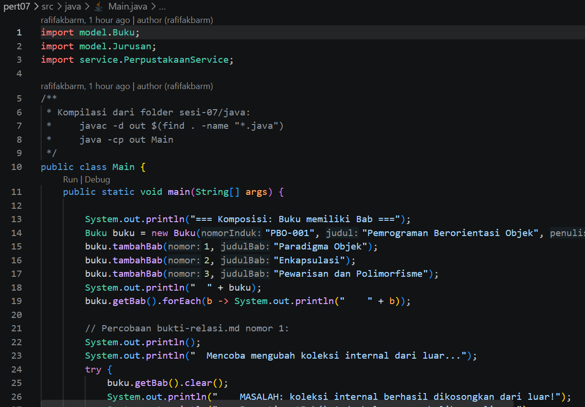
- **After** 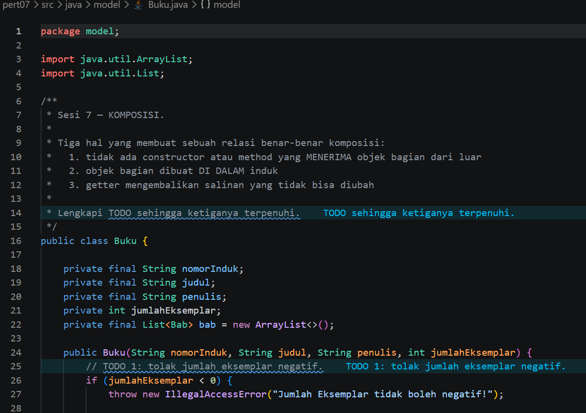
=======
> Program Main.java ini mendemonstrasikan konsep Pemrograman Berorientasi Objek dalam Java, khususnya perbedaan antara relasi Komposisi dan Agregasi. Selain itu, program ini juga menguji implementasi Service Layer melalui PerpustakaanService untuk mengelola koleksi buku serta simulasi transaksi peminjaman dan pengembalian.

**Bukti Eksekusi (Screenshot):**
- **Before** 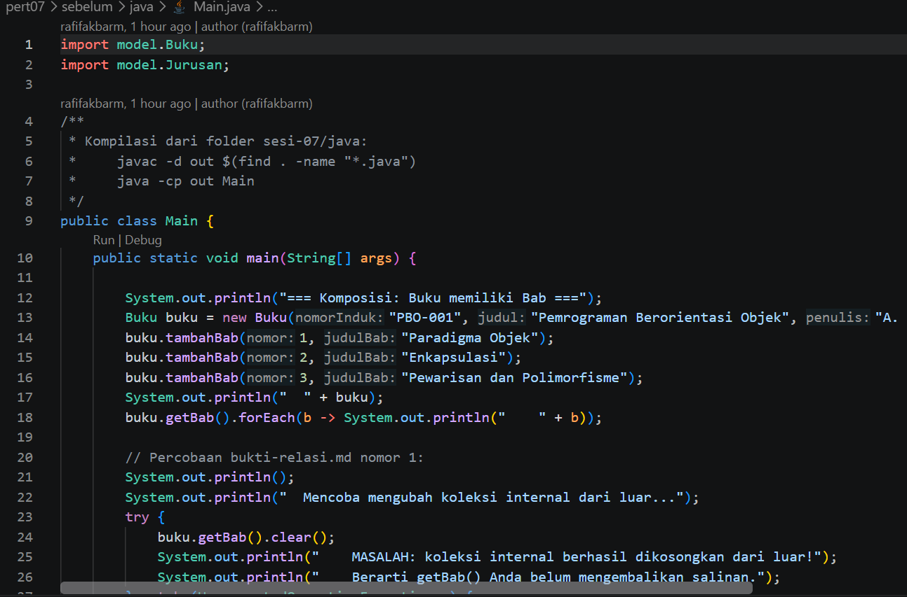
- **After** 
>>>>>>> ab1895db9547ef23fb4489bc61b63310557f4843

### 1.2. File: `Buku.java`

**Penjelasan Kode:**
<<<<<<< HEAD
> Kelas abstrak yang menyimpan data umum kendaraan, menyediakan perilaku bersama, dan mewajibkan kelas turunan mendefinisikan jumlah roda.

**Bukti Eksekusi (Screenshot):**
- **Before** 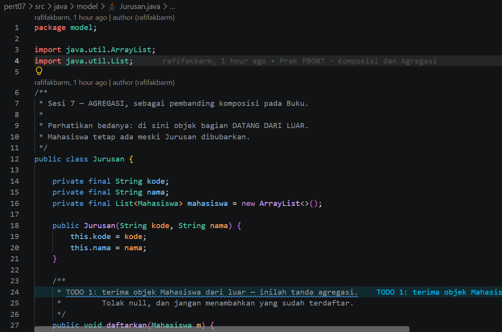
- **After** 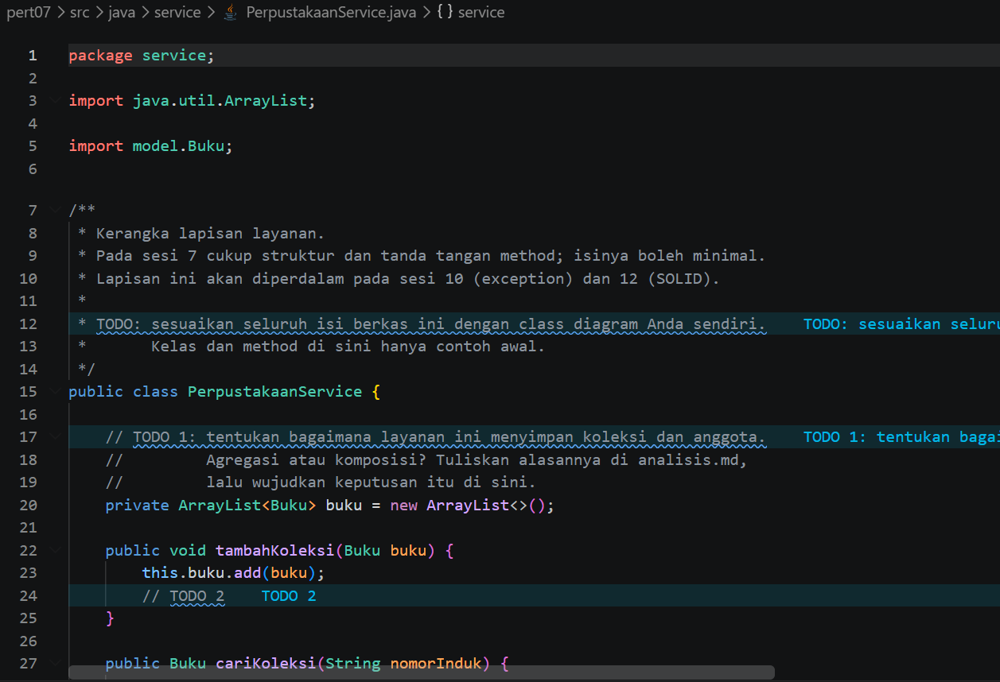
=======
> Buku.java mendemonstrasikan di mana objek Bab sepenuhnya dibentuk dan dikelola di dalam kelas Buku serta dilindungi dari modifikasi langsung di luar kelas melalui List.copyOf. Selain itu, kode ini menguji validasi data stok buku serta memberikan gambaran sistem perpustakaan secara keseluruhan.

**Bukti Eksekusi (Screenshot):**
- **Before** 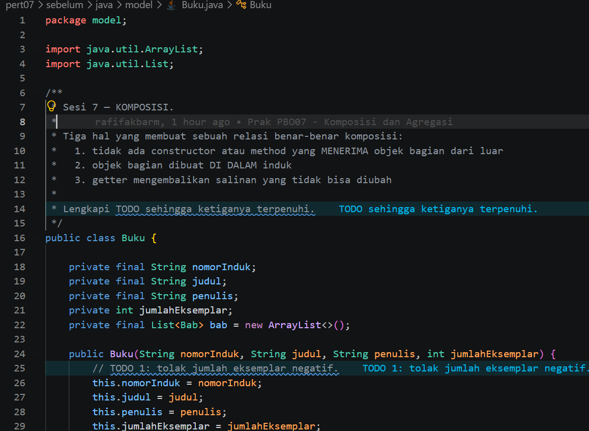
- **After** 
>>>>>>> ab1895db9547ef23fb4489bc61b63310557f4843

### 1.3. File: `Jurusan.java`

**Penjelasan Kode:**
<<<<<<< HEAD
> Kelas turunan Kendaraan yang mengimplementasikan Movable dan Fuelable, menyediakan informasi kapasitas tangki serta tipe bahan bakar.

**Bukti Eksekusi (Screenshot):**
- **Before** 
- **After** 
=======
> Jurusan.java mendemonstrasikan implementasi perbedaan relasi Komposisi objek Bab lahir dan hidup sepenuhnya di dalam Buku dan Agregasi.

**Bukti Eksekusi (Screenshot):**
- **Before** 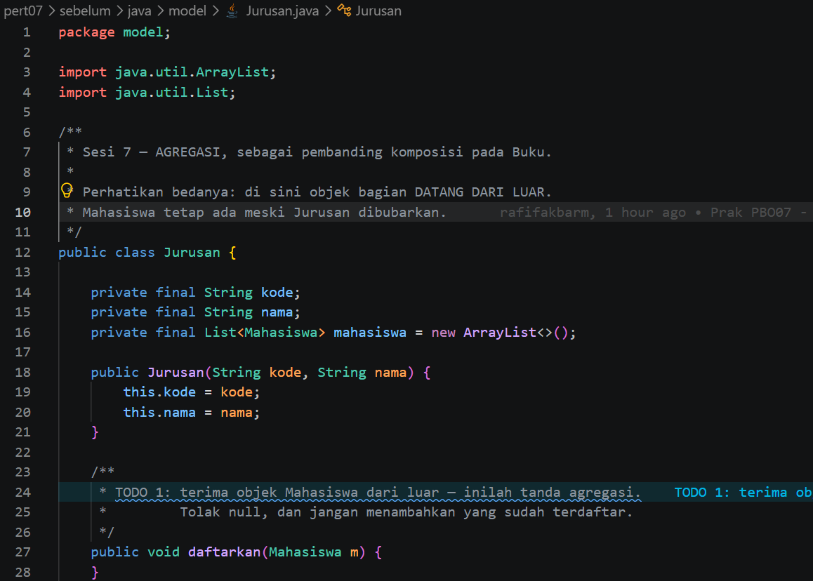
- **After** 
>>>>>>> ab1895db9547ef23fb4489bc61b63310557f4843

### 1.4. File: `PerpustakaanService.java`

**Penjelasan Kode:**
<<<<<<< HEAD
> Kelas turunan Kendaraan yang mengimplementasikan Movable. Sepeda dapat bergerak, tetapi tidak memenuhi kontrak Fuelable.

**Bukti Eksekusi (Screenshot):**
- **Before** 
- **After** 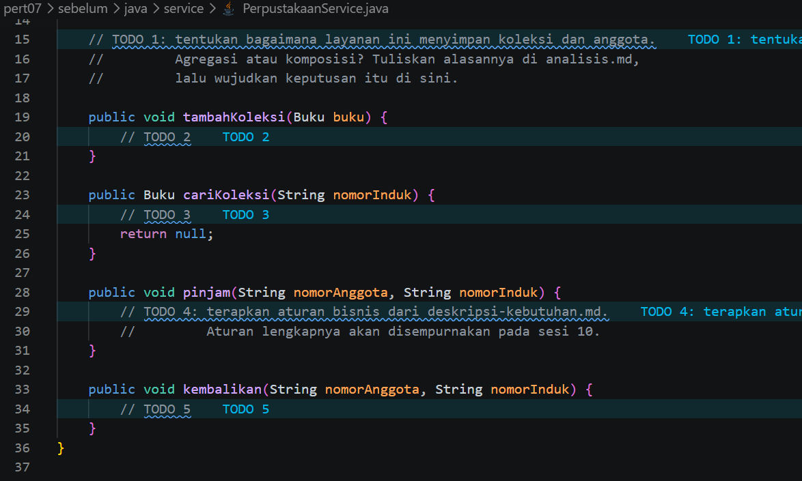
=======
> PerpustakaanService.java mendemonstrasikan implementasi perbedaan relasi Komposisi, Agregasi, serta penerapan PerpustakaanService untuk mengelola inventaris koleksi dan simulasi transaksi peminjaman buku.

**Bukti Eksekusi (Screenshot):**
- **Before** 
- **After** 
>>>>>>> ab1895db9547ef23fb4489bc61b63310557f4843

### Output

**Output Program:**

<<<<<<< HEAD

=======
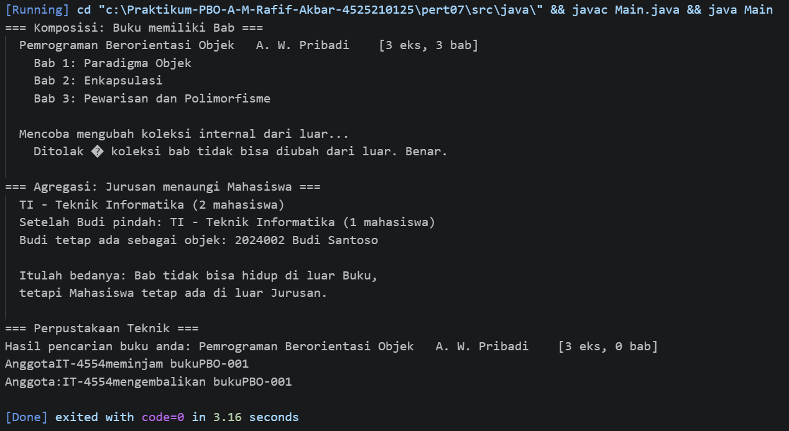
>>>>>>> ab1895db9547ef23fb4489bc61b63310557f4843

---

## 2. Implementasi PHP

### 2.1. File: `main.php`

**Penjelasan Kode:**
<<<<<<< HEAD
> Program PHP yang menjalankan objek kendaraan, mengisi bahan bakar melalui tipe Fuelable, menguji enum, dan memperlihatkan penggunaan trait.

**Bukti Eksekusi (Screenshot):**
- **Before** 
- **After** 

### 2.2. File: `abstraksi.php`

**Penjelasan Kode:**
> Berisi interface Movable dan Fuelable, enum TipeBahanBakar, serta trait Loggable untuk berbagi perilaku log. File ini juga menjadi tempat definisi abstraksi dan kelas pendukung PHP.

**Bukti Eksekusi (Screenshot):**
- **Before** 
- **After** 
=======
> Program ini mendemonstrasikan implementasi konsep Pemrograman Berorientasi Objek (PBO) dalam Java dan PHP, yang berfokus pada perbedaan relasi Komposisi dan Agregasi. Selain itu, program ini menguji enkapsulasi koleksi agar tidak dapat diubah dari luar serta mengelola kerangka layanan perpustakaan untuk inventaris dan transaksi buku.

**Bukti Eksekusi (Screenshot):**
- **Before** 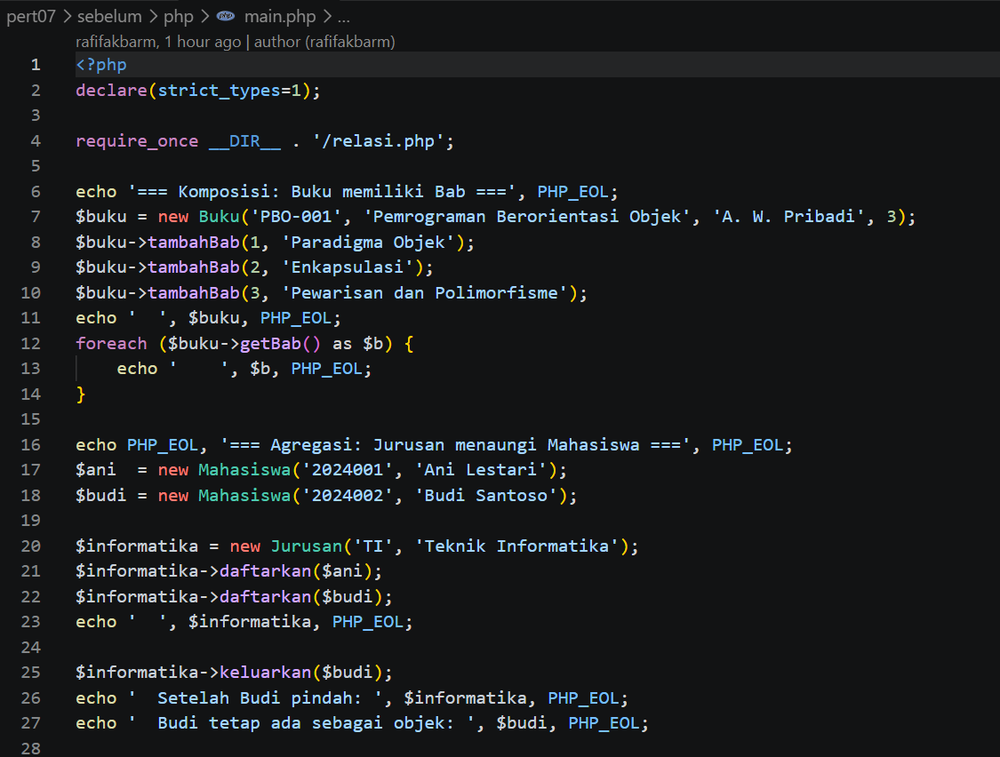
- **After** 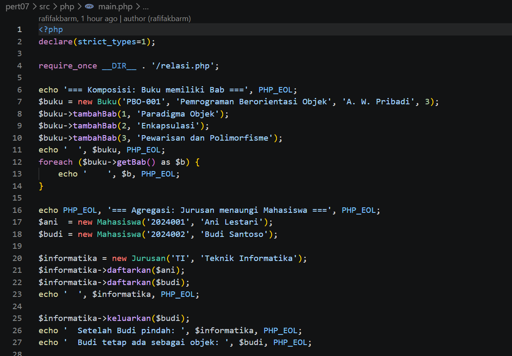

### 2.2. File: `relasi.php`

**Penjelasan Kode:**
> Program ini mendemonstrasikan dengan fokus utama pada perbandingan relasi Komposisi dan Agregasi. Selain itu, program ini menguji enkapsulasi pengembalian salinan koleksi agar aman dari modifikasi luar serta menyertakan kerangka layanan service layer untuk pengelolaan inventaris dan transaksi perpustakaan.
**Bukti Eksekusi (Screenshot):**
- **Before** 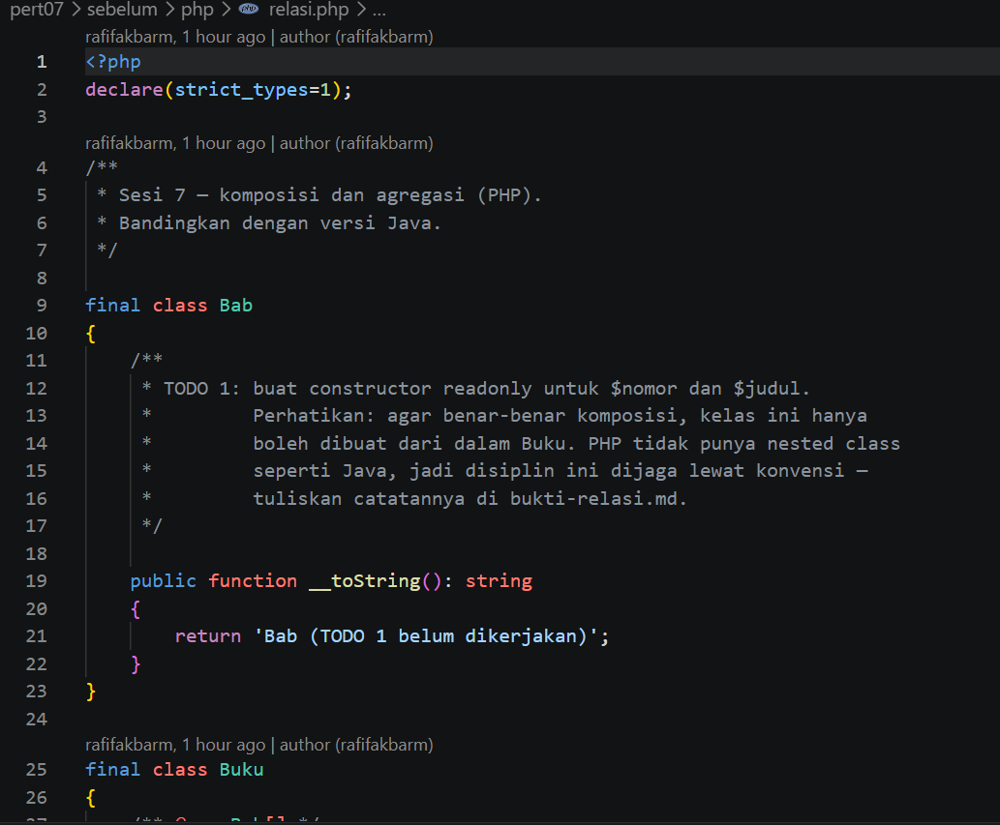
- **After** 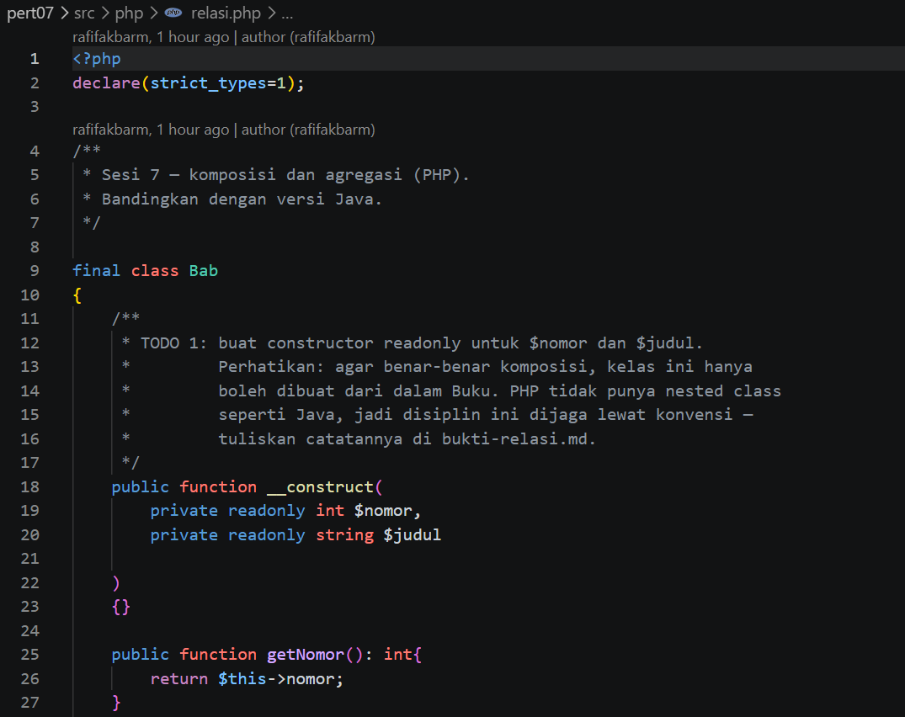
>>>>>>> ab1895db9547ef23fb4489bc61b63310557f4843
### Output

**Output Program:**

<<<<<<< HEAD

=======
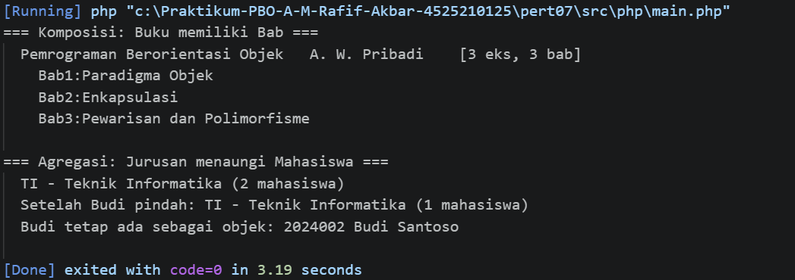
>>>>>>> ab1895db9547ef23fb4489bc61b63310557f4843

---

## 3. Kesimpulan

<<<<<<< HEAD
Abstract class digunakan untuk berbagi keadaan dan perilaku dasar sekaligus memaksa kelas turunan melengkapi method abstrak. Interface mendefinisikan kemampuan yang harus dimiliki kelas, sedangkan enum membatasi pilihan nilai yang sah. Pemisahan kontrak membuat fungsi seperti isiPenuh hanya menerima objek yang benar-benar mendukung pengisian bahan bakar.
=======
Komposisi dan agregasi adalah dua bentuk relasi antar-objek dalam Pemrograman Berorientasi Objek (PBO) yang dibedakan oleh tingkat ketergantungannya. Komposisi adalah hubungan erat di mana objek bagian (seperti Bab) sepenuhnya diciptakan dan bergantung pada objek induknya (Buku), sehingga tidak dapat berdiri sendiri jika induknya dimusnahkan. Sebaliknya, agregasi adalah hubungan longgar di mana objek bagian (seperti Mahasiswa) dibuat secara terpisah di luar dan tetap dapat hidup mandiri meskipun dilepaskan dari objek penaungnya (Jurusan).
>>>>>>> ab1895db9547ef23fb4489bc61b63310557f4843
