# LAPORAN PRAKTIKUM PEMROGRAMAN BERBASIS OBJEK

| Informasi Praktikan | Keterangan |
| :--- | :--- |
| **Nama** | Muhammad Rafif Akbar |
| **NPM** | 4525210125 |
| **Kelas** | A |
| **Mata Kuliah** | Pemrograman Berbasis Objek (PBO) |
| **Pertemuan** | 07 - Komposisi dan Agregasi |
| **Tanggal** | Kamis 15 Oktober 2026 |

---

## 1. Implementasi Java

### 1.1. File: `Main.java`

**Penjelasan Kode:**
> Program Main.java ini mendemonstrasikan konsep Pemrograman Berorientasi Objek dalam Java, khususnya perbedaan antara relasi Komposisi dan Agregasi. Selain itu, program ini juga menguji implementasi Service Layer melalui PerpustakaanService untuk mengelola koleksi buku serta simulasi transaksi peminjaman dan pengembalian.

**Bukti Eksekusi (Screenshot):**
- **Before** 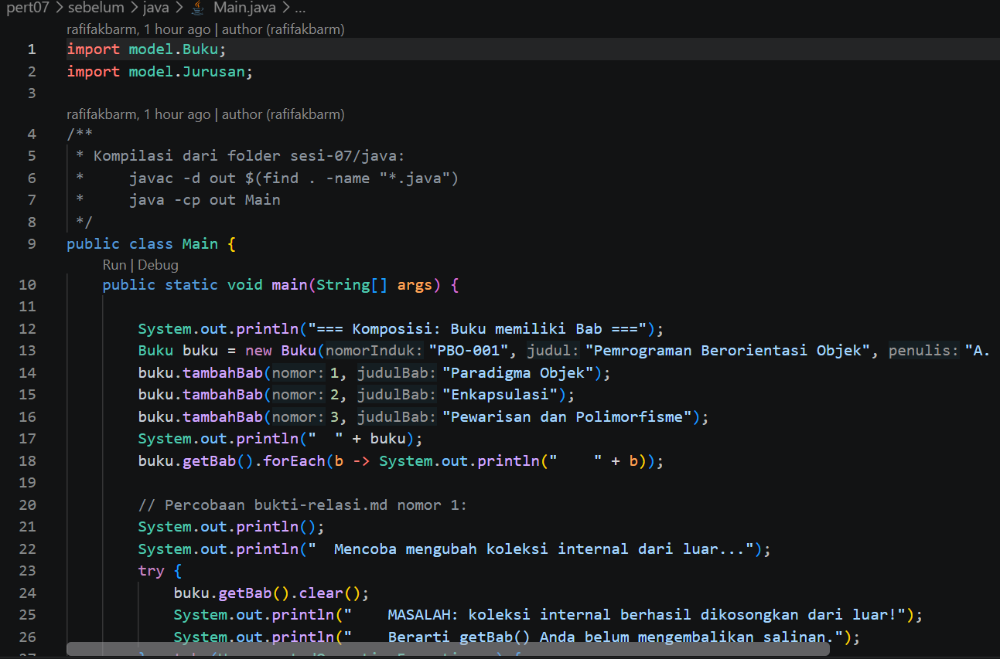
- **After** 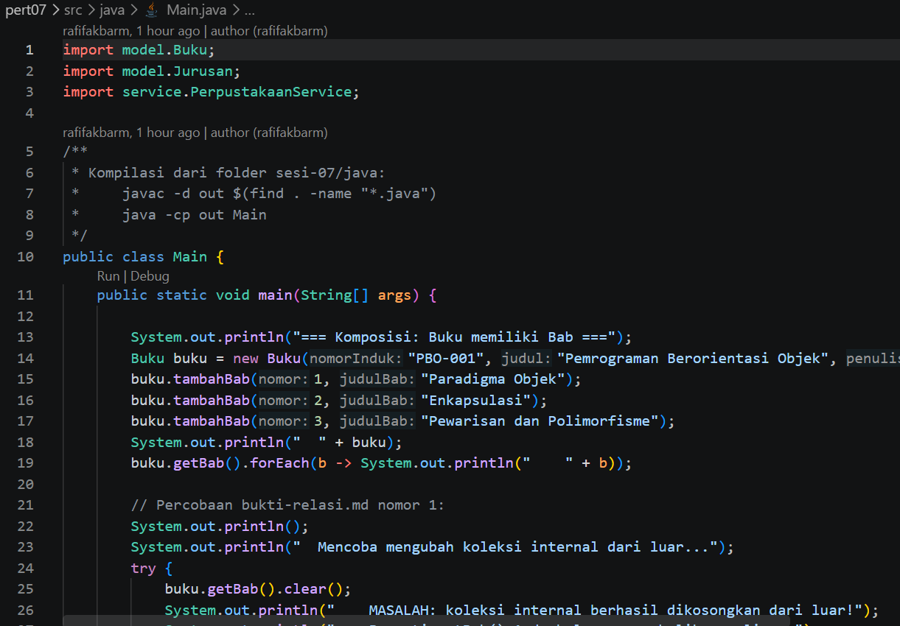

### 1.2. File: `Buku.java`

**Penjelasan Kode:**
> Buku.java mendemonstrasikan di mana objek Bab sepenuhnya dibentuk dan dikelola di dalam kelas Buku serta dilindungi dari modifikasi langsung di luar kelas melalui List.copyOf. Selain itu, kode ini menguji validasi data stok buku serta memberikan gambaran sistem perpustakaan secara keseluruhan.

**Bukti Eksekusi (Screenshot):**
- **Before** 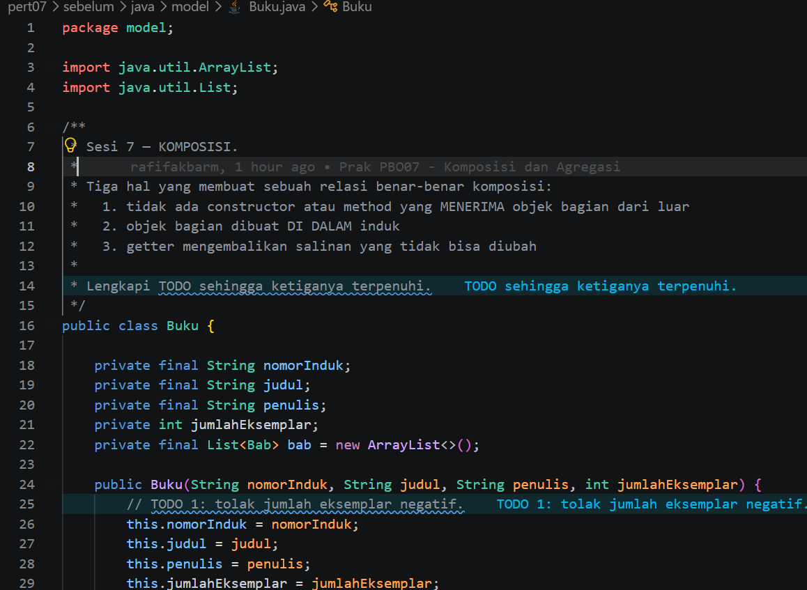
- **After** 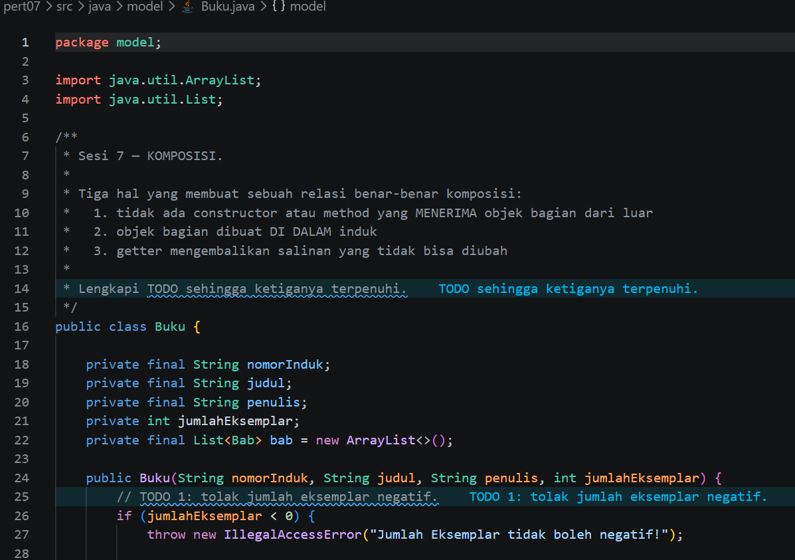

### 1.3. File: `Jurusan.java`

**Penjelasan Kode:**
> Jurusan.java mendemonstrasikan implementasi perbedaan relasi Komposisi objek Bab lahir dan hidup sepenuhnya di dalam Buku dan Agregasi.

**Bukti Eksekusi (Screenshot):**
- **Before** 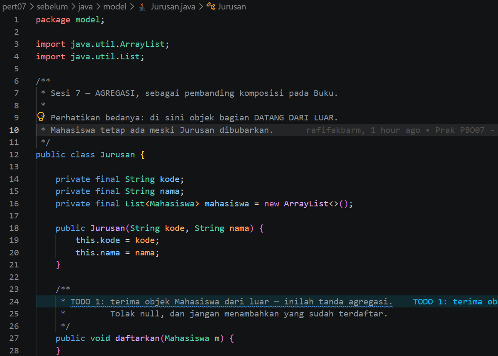
- **After** 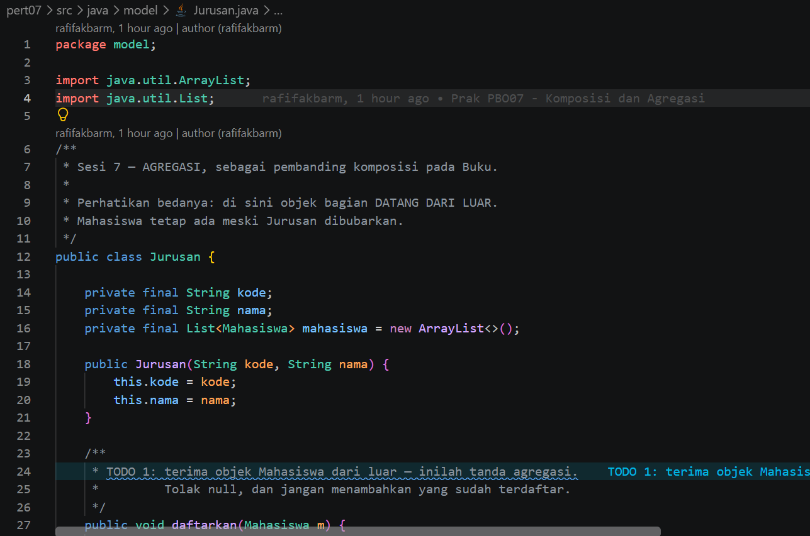

### 1.4. File: `PerpustakaanService.java`

**Penjelasan Kode:**
> PerpustakaanService.java mendemonstrasikan implementasi perbedaan relasi Komposisi, Agregasi, serta penerapan PerpustakaanService untuk mengelola inventaris koleksi dan simulasi transaksi peminjaman buku.

**Bukti Eksekusi (Screenshot):**
- **Before** 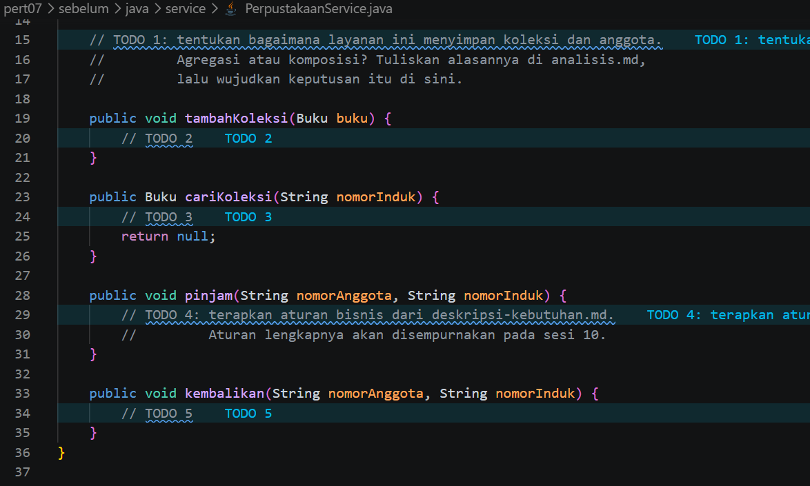
- **After** 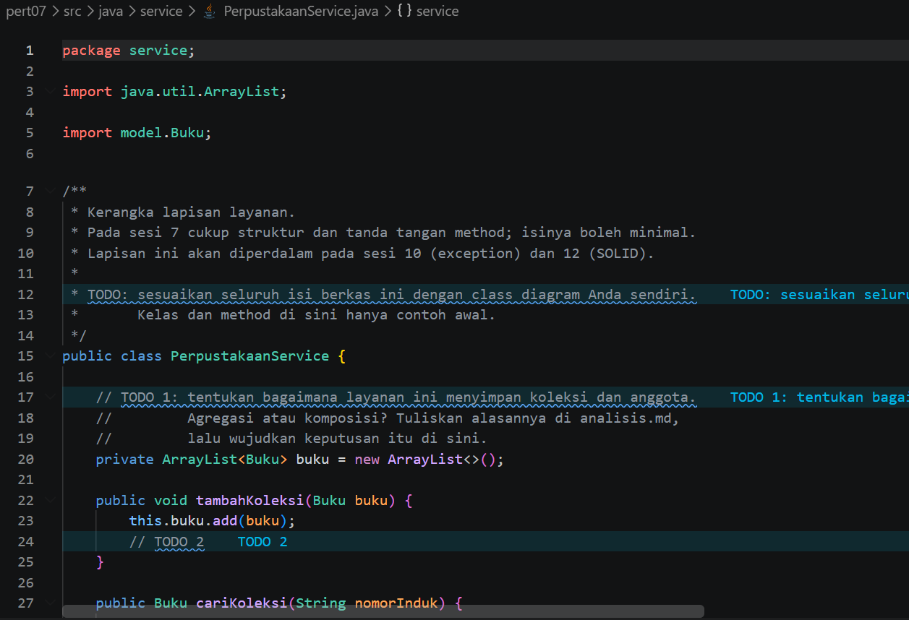

### Output

**Output Program:**

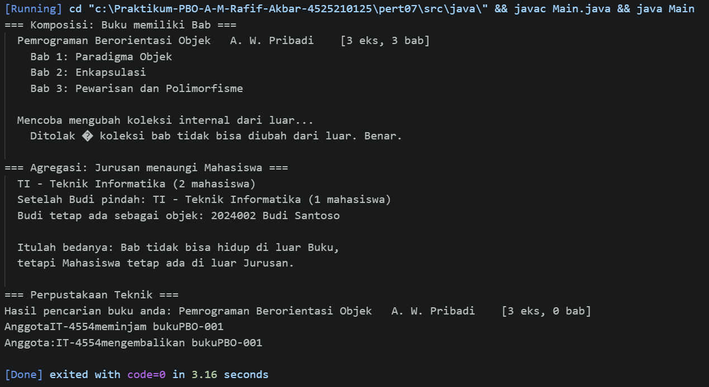

---

## 2. Implementasi PHP

### 2.1. File: `main.php`

**Penjelasan Kode:**
> Program ini mendemonstrasikan implementasi konsep Pemrograman Berorientasi Objek (PBO) dalam Java dan PHP, yang berfokus pada perbedaan relasi Komposisi dan Agregasi. Selain itu, program ini menguji enkapsulasi koleksi agar tidak dapat diubah dari luar serta mengelola kerangka layanan perpustakaan untuk inventaris dan transaksi buku.

**Bukti Eksekusi (Screenshot):**
- **Before** 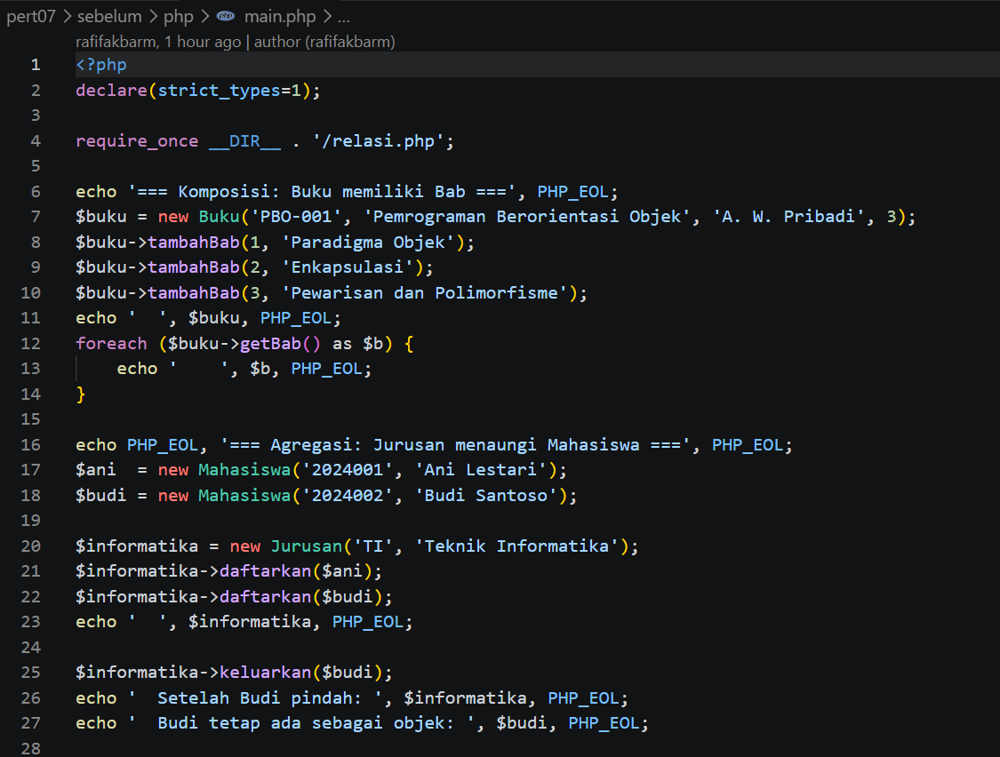
- **After** 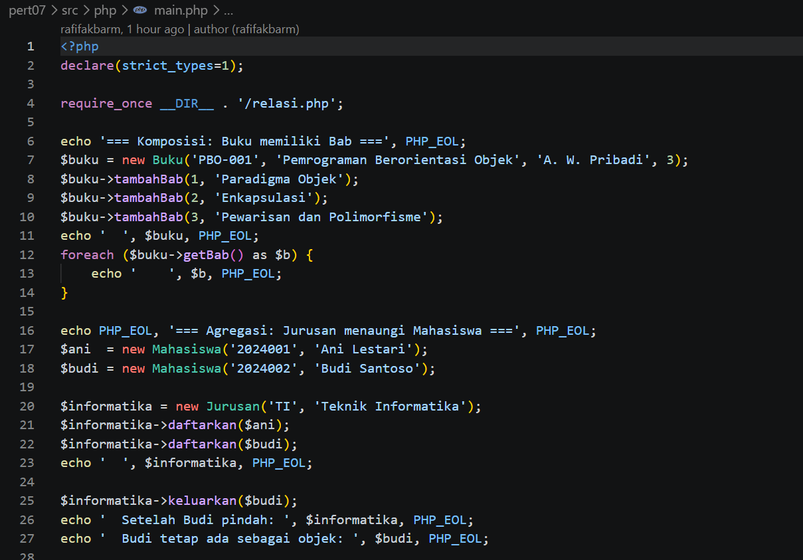

### 2.2. File: `relasi.php`

**Penjelasan Kode:**
> Program ini mendemonstrasikan dengan fokus utama pada perbandingan relasi Komposisi dan Agregasi. Selain itu, program ini menguji enkapsulasi pengembalian salinan koleksi agar aman dari modifikasi luar serta menyertakan kerangka layanan service layer untuk pengelolaan inventaris dan transaksi perpustakaan.
**Bukti Eksekusi (Screenshot):**
- **Before** 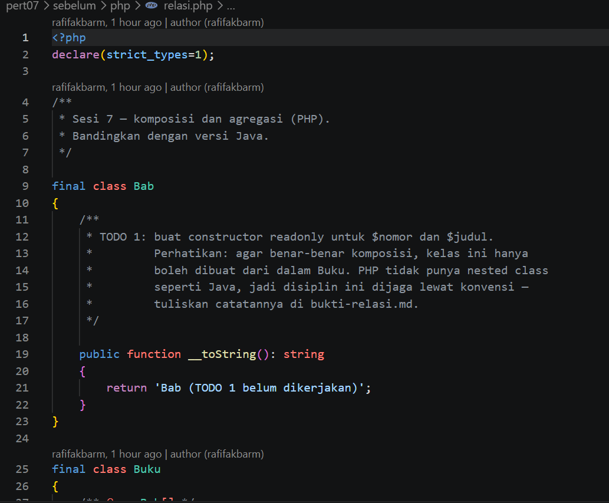
- **After** 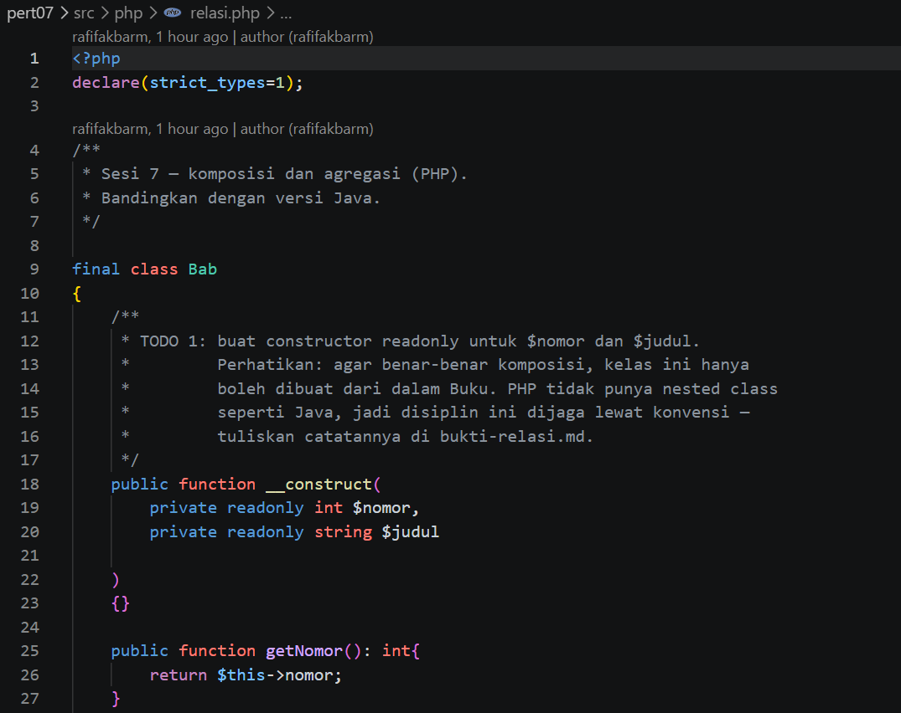
### Output

**Output Program:**

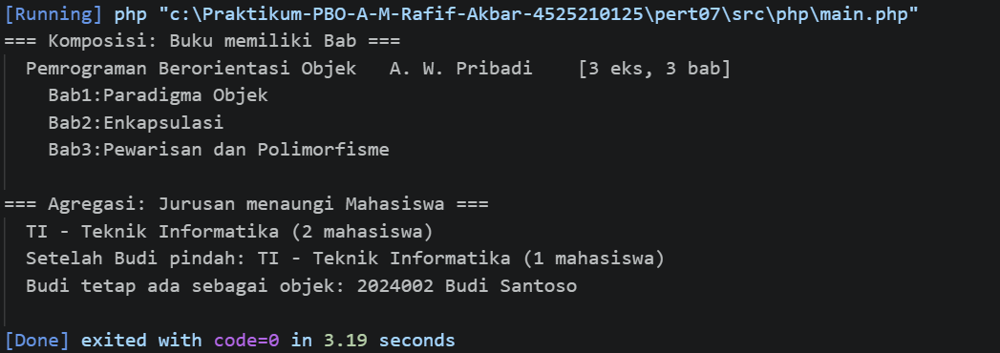

---

## 3. Kesimpulan

Komposisi dan agregasi adalah dua bentuk relasi antar-objek dalam Pemrograman Berorientasi Objek (PBO) yang dibedakan oleh tingkat ketergantungannya. Komposisi adalah hubungan erat di mana objek bagian (seperti Bab) sepenuhnya diciptakan dan bergantung pada objek induknya (Buku), sehingga tidak dapat berdiri sendiri jika induknya dimusnahkan. Sebaliknya, agregasi adalah hubungan longgar di mana objek bagian (seperti Mahasiswa) dibuat secara terpisah di luar dan tetap dapat hidup mandiri meskipun dilepaskan dari objek penaungnya (Jurusan).