# LAPORAN PRAKTIKUM PEMROGRAMAN BERBASIS OBJEK

| Informasi Praktikan | Keterangan |
| :--- | :--- |
| **Nama** | Muhammad Rafif Akbar |
| **NPM** | 4525210125 |
| **Kelas** | A |
| **Mata Kuliah** | Pemrograman Berbasis Objek (PBO) |
| **Pertemuan** | 12 - Prinsip Solid dan Desaign Pattern Dasar |
| **Tanggal** | Kamis 12 November 2026 |

---

## 1. Implementasi Java

### 1.1. File: `AturanDenda.java`

**Penjelasan Kode:**
> Interface yang menjadi kontrak Strategy Pattern untuk menghitung denda keterlambatan. Berisi dua method: hitung(int hariTerlambat) yang mengembalikan nilai denda, dan nama() untuk menampilkan nama aturan pada laporan. LibraryService hanya bergantung pada interface ini, bukan pada kelas denda tertentu.

**Bukti Eksekusi (Screenshot):**
- **After** 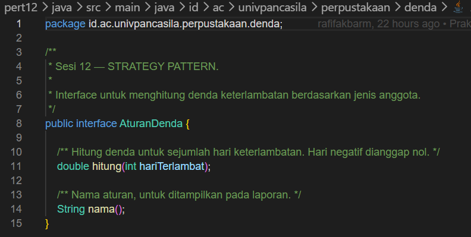

### 1.2. File: `AturanDendaFactory.java`

**Penjelasan Kode:**
> Factory untuk memilih implementasi AturanDenda berdasarkan jenis anggota. Constructor-nya private (kelas utilitas), dan method static untuk(String jenisAnggota) menolak null, lalu memakai switch pada teks yang sudah di-trim dan diubah ke huruf kecil: "mahasiswa" menghasilkan DendaMahasiswa, "dosen" DendaDosen, "kehormatan" atau "bebas" DendaBebas, dan "alumni" DendaAlumni. Jenis yang tidak dikenal melempar IllegalArgumentException.

**Bukti Eksekusi (Screenshot):**
- **After** 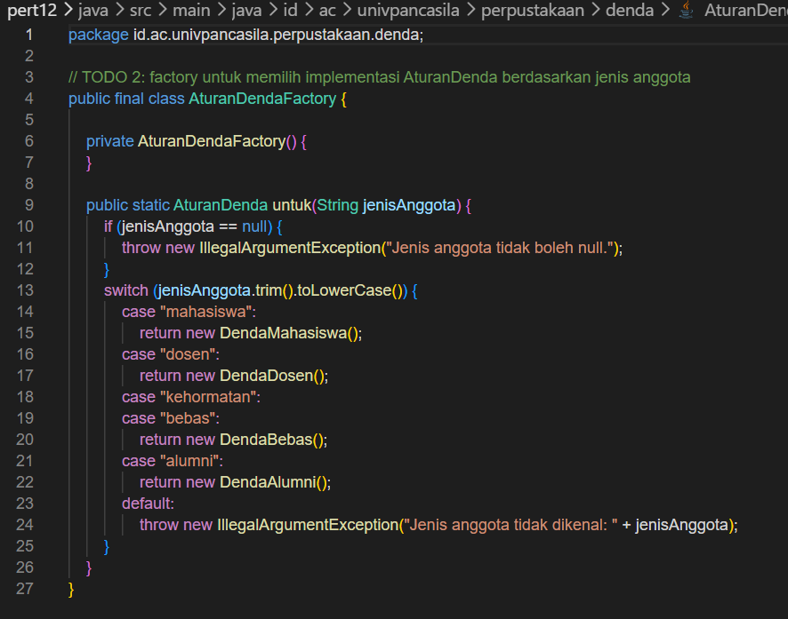

### 1.3. File: `DendaMahasiswa.java`

**Penjelasan Kode:**
> Implementasi AturanDenda untuk mahasiswa dengan tarif Rp1.000 per hari (konstanta TARIF_PER_HARI). hitung() mengalikan hari terlambat dengan tarif, memakai Math.max(0, ...) sehingga hari negatif dianggap nol. nama() mengembalikan "Mahasiswa (Rp1.000/hari)".

**Bukti Eksekusi (Screenshot):**
- **After** 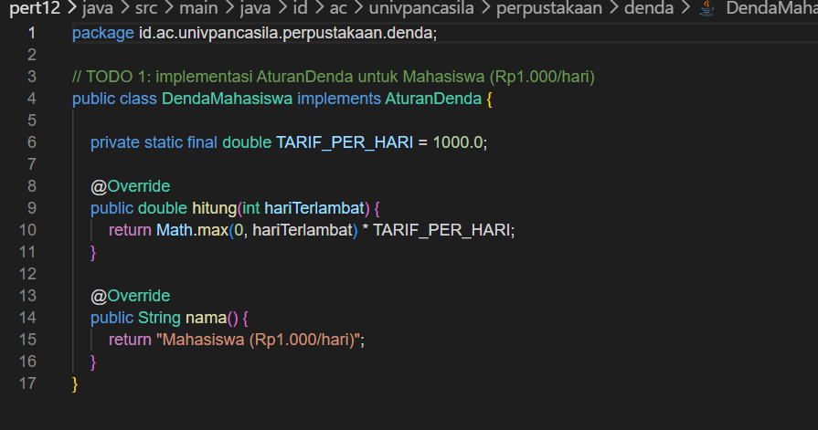

### 1.4. File: `DendaDosen.java`

**Penjelasan Kode:**
> Implementasi AturanDenda untuk dosen dengan tarif Rp500 per hari. Rumus dan penanganan hari negatif sama dengan DendaMahasiswa, hanya tarifnya yang berbeda. nama() mengembalikan "Dosen (Rp500/hari)".

**Bukti Eksekusi (Screenshot):**
- **After** 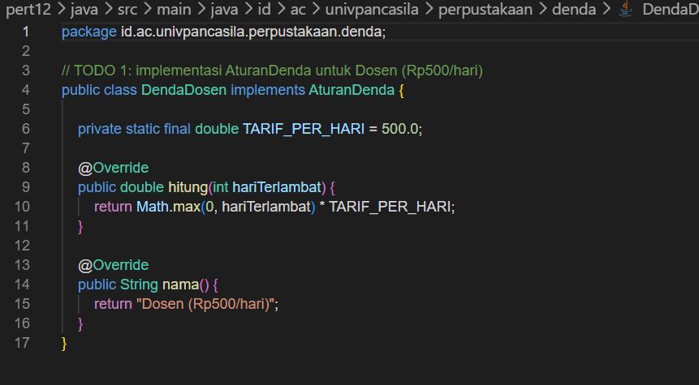

### 1.5. File: `DendaBebas.java`

**Penjelasan Kode:**
> Implementasi AturanDenda untuk Anggota Kehormatan: hitung() selalu mengembalikan 0.0 berapa pun hari keterlambatannya. nama() mengembalikan "Kehormatan (Bebas Denda)".

**Bukti Eksekusi (Screenshot):**
- **After** 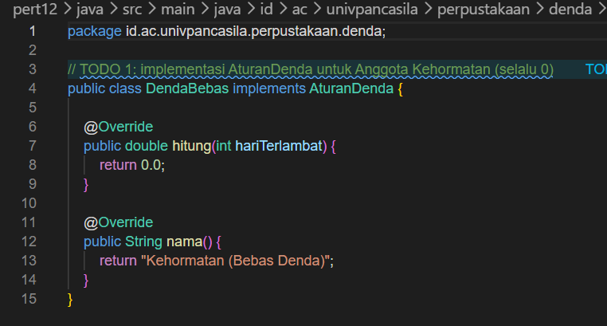

### 1.6. File: `DendaAlumni.java`

**Penjelasan Kode:**
> Aturan denda baru untuk alumni dengan tarif Rp750 per hari. Kelas ini menjadi bukti Open-Closed Principle: perilaku baru ditambahkan dengan membuat kelas baru yang mengimplementasikan AturanDenda (dan satu baris pada factory) tanpa menyunting LibraryService. nama() mengembalikan "Alumni (Rp750/hari)".

**Bukti Eksekusi (Screenshot):**
- **After** 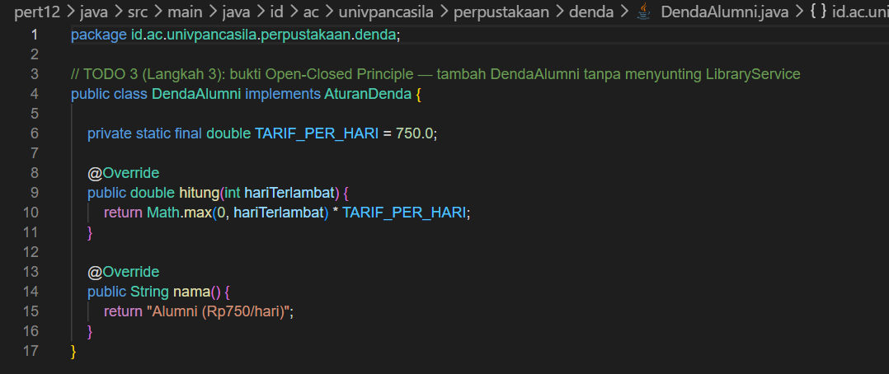

### Output

**Output Program:**
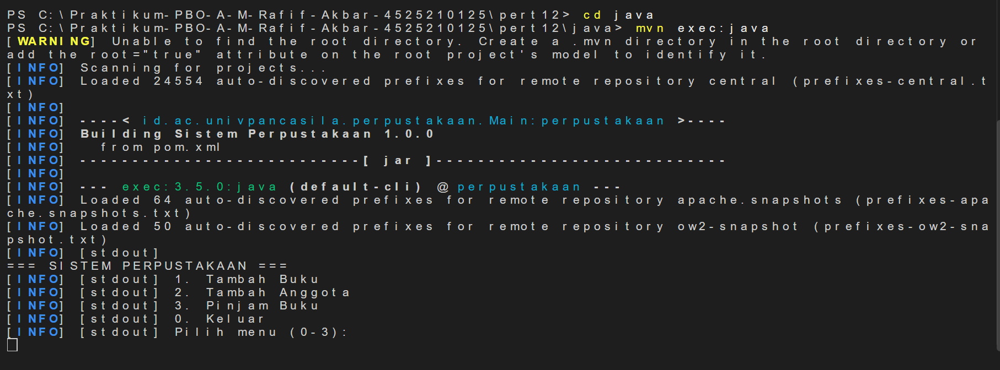

---

## 2. Implementasi PHP

### 2.1. File: `AturanDenda.php`

**Penjelasan Kode:**
> Interface (namespace Perpustakaan\Denda) yang menjadi kontrak Strategy Pattern di PHP: hitung(int $hariTerlambat): float untuk menghitung denda dan nama(): string untuk nama aturan. Memakai declare(strict_types=1) sehingga tipe parameter dan nilai kembalian diperiksa ketat.

**Bukti Eksekusi (Screenshot):**
- **After** 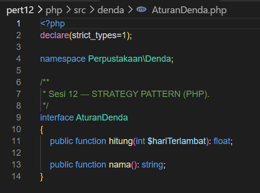

### 2.2. File: `AturanDendaFactory.php`

**Penjelasan Kode:**
> Factory dengan method static untuk(string $jenisAnggota): AturanDenda. Jenis anggota di-trim dan diubah ke huruf kecil, lalu dipilih lewat ekspresi match: 'mahasiswa' menghasilkan DendaMahasiswa, 'dosen' DendaDosen, 'kehormatan' atau 'bebas' DendaBebas, dan 'alumni' DendaAlumni. Jenis lain melempar InvalidArgumentException lewat cabang default.

**Bukti Eksekusi (Screenshot):**
- **After**  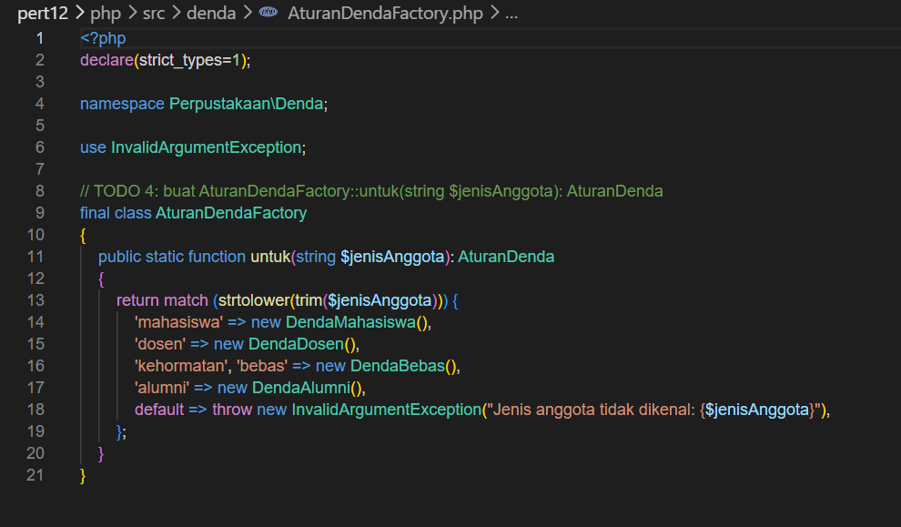

### 2.3. File: `DendaMahasiswa.php`

**Penjelasan Kode:**
> Implementasi AturanDenda berupa final class dengan konstanta TARIF_PER_HARI = 1000.0 (Rp1.000/hari). hitung() mengalikan max(0, $hariTerlambat) dengan tarif sehingga hari negatif dianggap nol, dan nama() mengembalikan "Mahasiswa (Rp1.000/hari)".

**Bukti Eksekusi (Screenshot):**
- **After** 

### 2.4. File: `DendaDosen.php`

**Penjelasan Kode:**
> Implementasi AturanDenda untuk dosen dengan tarif Rp500/hari. Rumusnya sama dengan DendaMahasiswa, hanya tarifnya berbeda, dan nama() mengembalikan "Dosen (Rp500/hari)".

**Bukti Eksekusi (Screenshot):**
- **After** 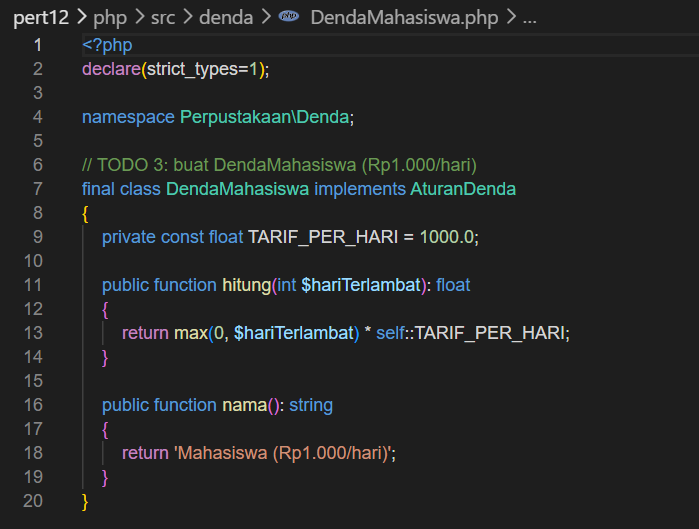

### 2.5. File: `DendaBebas.php`

**Penjelasan Kode:**
> Implementasi AturanDenda untuk Anggota Kehormatan: hitung() selalu mengembalikan 0.0, dan nama() mengembalikan "Kehormatan (Bebas Denda)".

**Bukti Eksekusi (Screenshot):**
- **After** 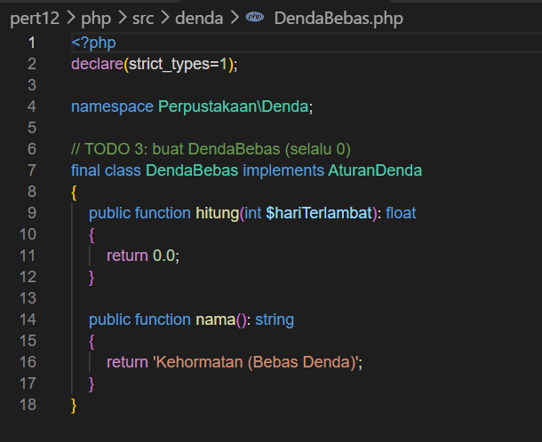

### 2.6. File: `DendaAlumni.php`

**Penjelasan Kode:**
> Aturan denda tambahan untuk alumni dengan tarif Rp750/hari. Menjadi bukti Open-Closed Principle: perilaku baru ditambahkan lewat kelas baru yang mengimplementasikan AturanDenda tanpa menyunting LibraryService.

**Bukti Eksekusi (Screenshot):**
- **After** 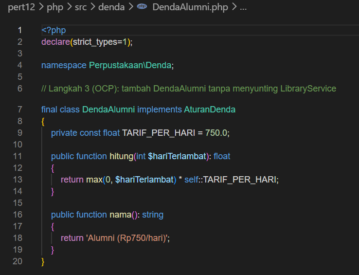

### Output

**Output Program:**
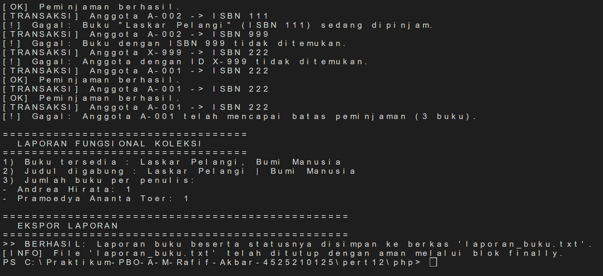

---

## 3. Kesimpulan

Pada pertemuan 12, perhitungan denda keterlambatan dirapikan dengan Strategy Pattern. Interface AturanDenda menjadi kontrak, dan setiap jenis anggota punya implementasi sendiri (DendaMahasiswa Rp1.000/hari, DendaDosen Rp500/hari, DendaBebas selalu 0, dan DendaAlumni Rp750/hari) sehingga tidak perlu percabangan if-else pada kode pemakainya. AturanDendaFactory memilih strategi yang tepat berdasarkan jenis anggota dan menolak jenis yang tidak dikenal. Penambahan DendaAlumni membuktikan Open-Closed Principle: perilaku baru cukup ditambahkan lewat kelas baru tanpa menyunting kelas yang sudah ada. Konsepnya sama di Java dan PHP, hanya sintaksnya yang berbeda (switch dan interface di Java, match dan strict_types di PHP).
